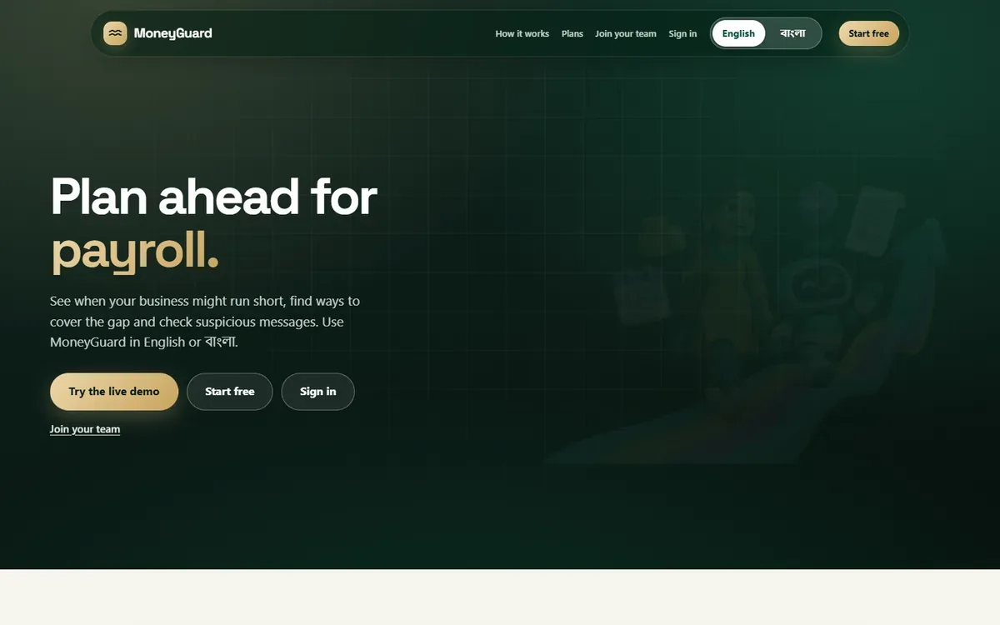
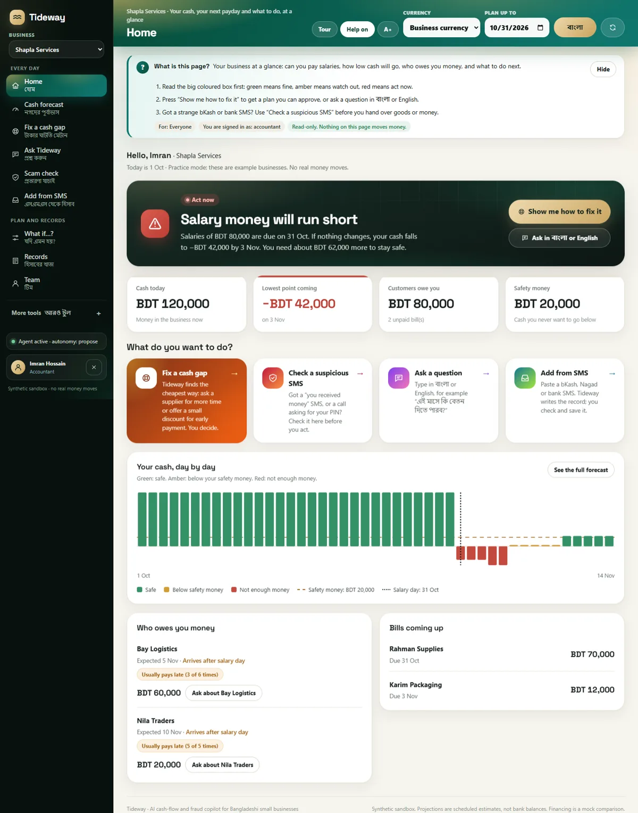
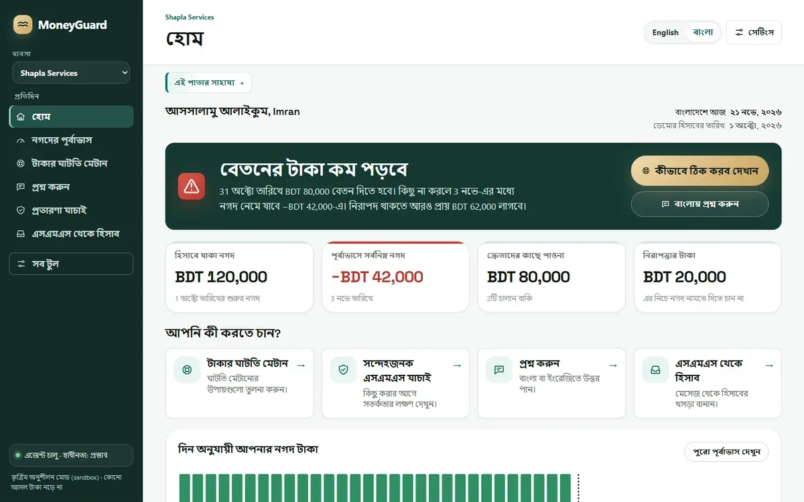
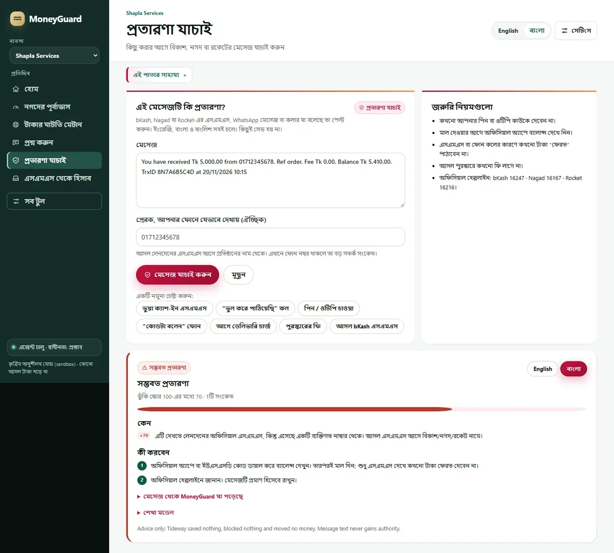
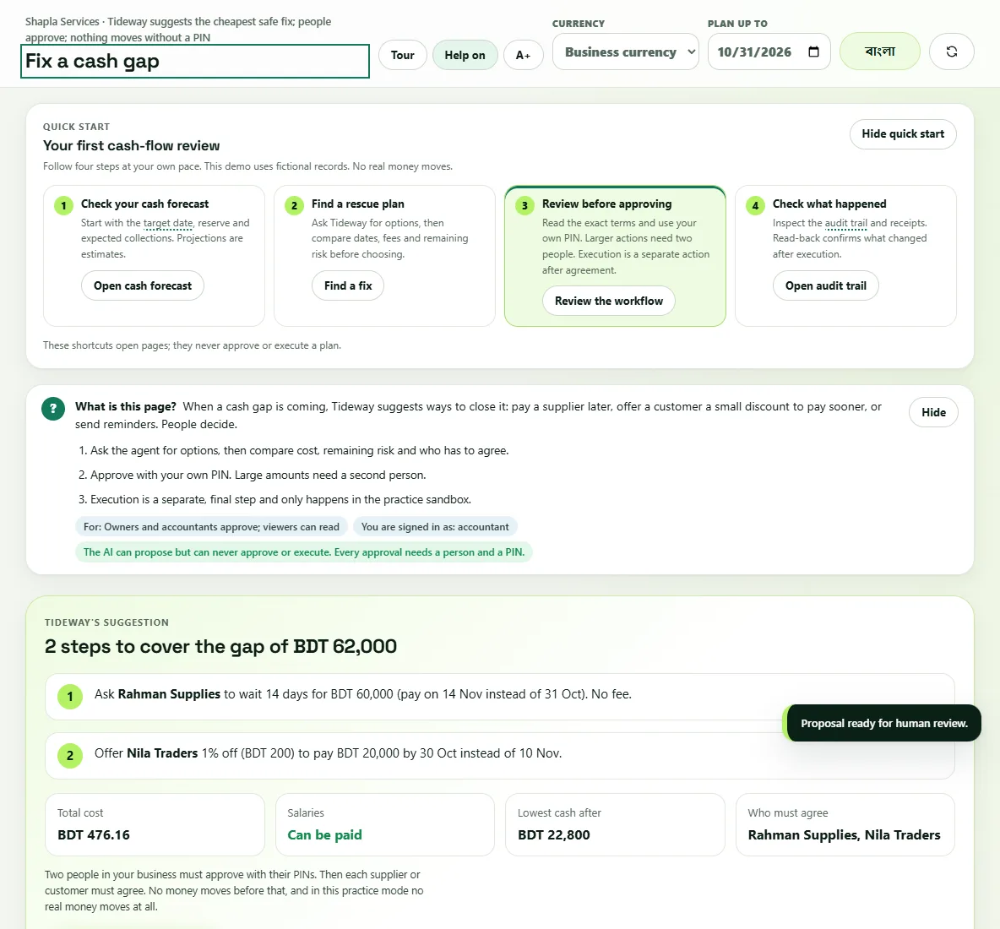
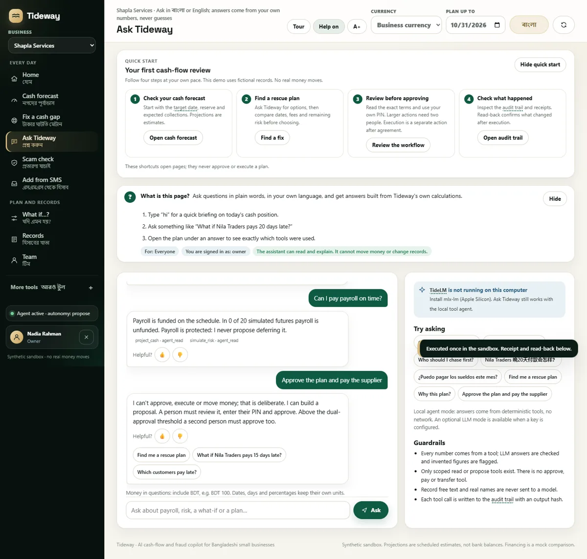
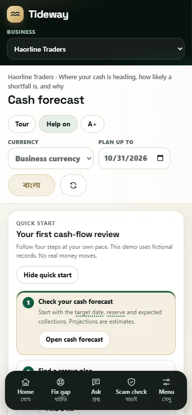
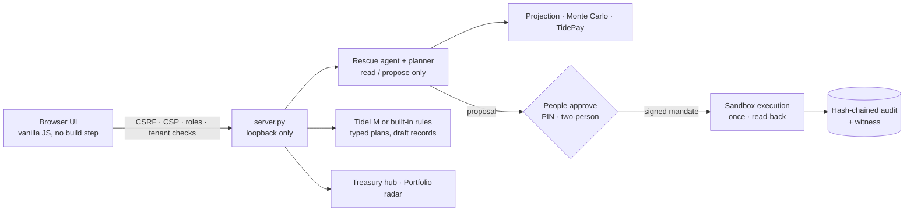

<div align="center">


<br>


**MU CSE Fest 2026 · Inter-University AI Builders Hackathon · Track 04: FinTech & Financial Intelligence**<br>
Built by **The Last BrainCell** · Bangladesh University of Engineering and Technology (BUET)

[Quick start](#quick-start) · [For the judges](#how-tideway-answers-the-fintech-track) · [Scam Shield](#scam-shield-mobile-money-fraud-check) · [বাংলা](#ask-in-বাংলা) · [Our AI](#tideways-own-ai) · [Security](#security-by-design) · [Docs](#documentation)

</div>

---

## Why Tideway

> A profitable shop in Sylhet can still miss payroll. Customers pay late, suppliers want cash on time, and the gap lands on salary day. The owner finds out too late, then borrows from an informal lender at a painful rate. On the same day, a fake bKash "cash-in" SMS or a "sent by mistake, please send it back" call can wipe out a week's profit.

Bangladesh's small businesses run on mobile money and trust, but they have no finance team. **Tideway is an AI financial copilot for them, with hard limits.** It forecasts the cash gap days ahead, predicts which customers will pay late, plans the cheapest safe rescue, checks suspicious bKash, Nagad and Rocket messages for fraud, and explains everything in **বাংলা** or English. Then it stops. **People approve** with a PIN, large amounts need **two people**, and only a **signed, expiring mandate** can execute, once, with proof.

## How Tideway answers the FinTech track

| Track theme | What Tideway does | Where to see it |
|---|---|---|
| **Fraud detection** | **Scam Shield** checks pasted MFS messages (fake cash-in SMS, PIN/OTP requests, wrong-send refund trick, prize fees, phishing links) with explainable rules plus a learned text model. Payment-integrity scan blocks changed bank details, look-alike payees and duplicate bills. | *Scam Shield*, *Inbox*, *Treasury → Payment integrity* |
| **Financial literacy** | **Money lessons (টাকার পাঠ):** six one-minute lessons (safety money, salary day, late payers, relying on one customer, MFS scams, getting a loan), each explained with the owner's own numbers and ending in a one-question check. Ask in **বাংলা**: "এই মাসে কি বেতন দিতে পারব?" Answers are built from the ledger's own numbers, never guessed. 40 finance terms explained on tap. | *Money lessons*, *Ask Tideway*, help layer |
| **Financial inclusion** | **Speak your question** in বাংলা or English with the microphone button, for owners who find typing hard. A signed **credit passport** turns a micro-business's cash-flow record into evidence a bank or MFI can verify offline, without collateral history. A lender **portfolio radar** spots SMEs heading for trouble weeks early. | *Treasury → Credit passport*, *Portfolio radar* |
| **Digital finance** | Reads bKash, Nagad, Rocket and bank alerts into draft ledger records (nothing saved until a person confirms), forecasts cash 14 days ahead with 1,000 simulated futures, and plans supplier deferrals and early-payment discounts. Payment reminders and supplier requests are written in **বাংলা** with a **Copy** button for SMS or WhatsApp. | *Inbox*, *Cash weather*, *Rescue plan* |

The one-page mapping to the hackathon's rules and judging criteria is in [docs/MU_HACKATHON_2026.md](docs/MU_HACKATHON_2026.md); the 3-page proposal is in [docs/proposal/](docs/proposal/).



## Who it helps


| Who | Their problem | How Tideway helps |
|---|---|---|
| **SME owner** | Payroll surprises, no time for spreadsheets, MFS scams | A 14-day cash forecast with the odds of a shortfall, a ranked rescue plan, Scam Shield and answers in বাংলা |
| **Finance team** | Manual data entry, duplicate or redirected payments | Zero-entry inbox, 13-week cash flow, payment-integrity scan and maker-checker approvals |
| **Bank or MFI** | Thin-file SMEs, late signals of distress | A portfolio radar that ranks clients by breach risk, and credit passports verified offline with a public key |
| **Large buyer** | A small supplier's cash crunch breaks the supply chain | Early warning on suppliers heading for a gap, and two-business negotiation that protects both payrolls |
| **Auditor** | AI actions that cannot be traced | Every step signed, hash-chained with an independent witness and replayable; a one-click tamper drill |

## See it in action



<table>
<tr>
<td width="50%" valign="top"><b>Home: one plain answer first</b><br><br><sub>Can I pay salaries? How low will cash go? Who owes me? What should I do? Answered at a glance, with one button to fix it.</sub></td>
<td width="50%" valign="top"><b>The whole app in বাংলা</b><br><br><sub>An English | বাংলা switch turns every page into Bangla, checked automatically across 33 page states (<code>node scripts/bangla_coverage.mjs --strict</code>).</sub></td>
</tr>
<tr>
<td valign="top"><b>Scam check</b><br><br><sub>A fake cash-in SMS from an 01X number is flagged, with the reason and safe next steps in English and বাংলা.</sub></td>
<td valign="top"><b>Fix a cash gap in plain words</b><br><br><sub>Each step in one sentence, the total cost, whether salaries can be paid and who must agree; then approve with a PIN.</sub></td>
</tr>
<tr>
<td valign="top"><b>Ask in your own words</b><br><br><sub>Ask in বাংলা, English or Banglish. The tools used are shown under every answer.</sub></td>
<td valign="top"><b>Made for phones</b><br><br><sub>Most owners use a phone: a bottom tab bar keeps Home, Fix gap, Ask and Scam check one tap away.</sub></td>
</tr>
</table>

Treasury hub, lender radar, decision lab and the tamper-evident audit trail are under **More tools** for accountants and lenders.

## Scam Shield: mobile-money fraud check

Paste a bKash, Nagad or Rocket SMS, a WhatsApp message or what a caller said, plus (optionally) the sender shown on the phone. Scam Shield returns **Likely scam / Suspicious / No known red flags**, a 0–100 risk score, every reason in **English and বাংলা**, and safe next steps (check the balance in the official app or USSD code, never return money because of an SMS, report to the official helpline).

- **Explainable rules** for the patterns common in Bangladesh: PIN/OTP requests (with negation handling, so "bKash never asks for your PIN" is not flagged), the wrong-send refund trick, fake cash-in SMS sent from a personal 01X number, prize/loan/job/parcel fees, account-block threats, fake officials, phishing links, payments to a "new" personal number, secrecy and instruction-injection text.
- **A learned text model**: multinomial naive Bayes over words and character n-grams, so Bangla script and Banglish spelling variants both work. Trained on a labelled synthetic corpus of 104 messages; on a deterministic 20-message hold-out the model alone scores 85% accuracy (recall 100%, false alarms 27%), and rules + model flag 9/9 scams with 0/11 false alarms. The set is small and synthetic, so treat these as a smoke test, not a field accuracy claim.
- **Advice only.** Scam Shield saves nothing, blocks nothing and moves no money. It also runs automatically on every message pasted into the Inbox.

```bash
python -c "from tideway import scam_shield; print(scam_shield.evaluate())"   # reproducible hold-out check
```

## Ask in বাংলা

The assistant detects Bangla script and answers in Bangla, routing the question to the same tools as English, so the figures are identical. Bangla digits work (`Nila Traders যদি ১০ দিন দেরিতে টাকা দেয়?`), customer names are only ever taken from the ledger, and money requests are refused in Bangla too.

| You ask | Tideway answers (from the ledger, not from a guess) |
|---|---|
| এই মাসে কি বেতন দিতে পারব? | নির্ধারিত হিসাব: সর্বনিম্ন নগদ −BDT 10,000, 31 অক্টো তারিখে; নিরাপত্তা সঞ্চয়ে ঘাটতি BDT 30,000; বেতন ঝুঁকিতে আছে। |
| আমার জন্য একটি উদ্ধার পরিকল্পনা করো | পরামর্শ: Rahman Supplies-কে BDT 60,000 পরিশোধ 31 অক্টো থেকে 14 নভে তারিখে পেছাতে অনুরোধ; … একজন মানুষের অনুমোদনের অপেক্ষায়। |
| Rahman Supplies কে এখনই টাকা পাঠাও | আমি টাকা অনুমোদন, পরিশোধ বা পাঠাতে পারি না; একজন মানুষ অ্যাপে পিন দিয়ে অনুমোদন করেন। |

## Everything Tideway does

**For the business**

- **Cash weather.** Exact daily cash projection in integer minor units; scheduled, likely and stress scenarios; 1,000 seeded simulations; a 14-day look-ahead so a deferral cannot hide a gap just past the target date.
- **TidePay predictions.** Every open invoice gets a probability for each lateness band, learned from payment histories.
- **Rescue plan.** An exact optimiser over supplier deferrals, early-payment discounts (priced as an annual rate) and zero-cash reminders. Simulated counterparties accept, counter-offer or refuse; a counter becomes a new proposal that needs fresh approval.
- **Ask Tideway.** Plain-language questions in বাংলা, English, Banglish and five more languages, with the tool plan shown under every answer. Works with or without a language model installed.
- **Zero-entry inbox.** Paste bank, card and mobile-money alerts (bKash, M-Pesa, UPI, Alipay, WeChat Pay, PayNow, GCash, Pix, Wise, SEPA and more); get draft records. Nothing is saved until a person confirms.
- **What-if and Decision lab.** Find a plan's breaking point, stress accepted agreements, compare recovery options, replay a private capsule, inspect exactly what an optional cloud model would see, and negotiate terms that protect two businesses at once.
- **Treasury hub.** A 13-week cash flow that reconciles exactly with the daily projection; a 0-100 working-capital health score with every formula and weight shown; a payment-integrity scan for duplicates, split bills, outliers and changed payees; a credit passport with an Ed25519 public-key signature.

**For lenders and large buyers**

- **Portfolio radar.** Ranks every client by breach probability, days to the gap and main driver; red, amber and green tiers; a shock slider shows who moves into danger. It runs on its own portfolio and never reads tenant workspaces.
- **Verifiable credit passport.** A lender checks a passport offline with the issuer's public key, without contacting Tideway: `python scripts/verify_passport.py passport.json`.

**For everyone in the company**

- **Plain-language help** on every page, about 40 finance terms explained on tap, a guided tour and a larger-text mode.
- **Workspaces and roles.** Sign up a business in any of 29 currencies, invite your accountant by one-time code, and keep tenants fully isolated.
- **Exports.** Evidence JSON, records and receipts CSV (spreadsheet-formula-safe), a 13-week cash-flow CSV, a bank pack and a draft ISO 20022 `pain.001` payment file that is never sent.

## Tideway's own AI

Trained by the team, running on the device. The language model can only propose; validators, permissions and people decide.

| Model | What it does | Result on held-out synthetic tests |
|---|---|---|
| **TidePay** | Predicts how late each invoice will be paid (federated training across 40 simulated SMEs) | Mean error **8.56 days** vs 10.23 for a history heuristic, on 7,427 unseen invoices |
| **TideLM** (Qwen3-4B + LoRA, Apple Silicon) | Turns questions and pasted alerts into typed tool plans and draft records | Exact plans **26.7% → 96.7%**, extraction F1 **0.83 → 0.969** |
| **TideLM** (Qwen3-1.7B + LoRA, NVIDIA RTX 3060 Ti) | The same task, trained in **7.3 minutes** on a consumer GPU | Exact plans **21.3% → 92.7%**, extraction F1 **0.30 → 0.99**, injection flags **62% → 100%** |
| **Scam Shield text model** (naive Bayes, words + character n-grams) | Scores how similar a pasted MFS message is to known scam patterns, in English, বাংলা and Banglish | Model alone **85%** accuracy on a 20-message hold-out; rules + model **9/9** scams flagged, **0/11** false alarms (small synthetic set) |

Details: [model card](docs/MODEL_CARD.md) · [Scam Shield](docs/SCAM_SHIELD.md) · [GPU training](docs/TIDELM_CUDA.md) · [TidePay evaluation](docs/DEPLOYED_MODEL_EVALUATION.md)

## Security by design

> **The golden rule:** no text, message or model output can approve or execute a payment. Moving money is never delegated to the AI.

| Control | What it does |
|---|---|
| **Permission tiers** | The agent can read and propose only. It has no approve, execute, SQL, shell or URL tool. |
| **Maker-checker + PIN step-up** | Large plans need two people, one of them the owner, plus a typed exposure amount. |
| **Signed, single-use mandates** | HMAC-signed, bound to the exact actions, snapshot and policy; they expire and execute once with read-back. |
| **Kill switch and circuit breaker** | The owner can pause the agent instantly; repeated security denials pause it automatically. |
| **Payee fraud blocks** | Changed bank details or look-alike names block the bill until verified by callback; separation of duties. |
| **Injection quarantine** | Suspicious text is kept as data and never treated as an instruction; Scam Shield flags instruction-injection inside pasted messages. |
| **Tamper-evident audit** | Hash-chained log with an independently keyed witness; truncation and edits are detected. |
| **Tenant isolation** | Membership and role are checked on every request; loopback-only server, strict CSP, CSRF and rate limits. |

[Security self-assessment](docs/SECURITY_SELF_ASSESSMENT.md) · [Security assessment PDF](docs/security-assessment.pdf)

## Architecture



Pure Python standard library at runtime: no packages, no API keys and no internet needed for the core app.

## Quick start

```bash
git clone https://github.com/ramim167/tideway-mu-2026.git
cd tideway-mu-2026
python run.py
```

Open <http://127.0.0.1:8787> and click **Nadia (Owner)**. Demo PINs: Nadia `2468` (owner), Imran `1357` (accountant), Guest `0000` (viewer).

**A two-minute tour:** check **Cash weather** → open **Scam Shield** and try the *Fake cash-in SMS* sample → ask **Ask Tideway** `এই মাসে কি বেতন দিতে পারব?` → run the **Rescue plan** and approve with Nadia, then Imran → paste the injection sample into **Inbox** → run the **Security centre** self-test → open **Treasury** and **Portfolio radar** → run the **Evidence** tamper drill.

```bash
docker build -t tideway:local . && docker run --rm -p 127.0.0.1:8787:8787 tideway:local   # isolated container
python run.py --no-demo --db data/empty.sqlite3                                         # empty workspace
```

**Optional: free cloud AI, with automatic fallback.** Not needed for anything above. Copy `.env.example` to `.env` and fill any of: `GEMINI_API_KEY` (Google AI Studio, free tier, good at Bangla), `GROQ_API_KEY` (free tier), `OPENROUTER_API_KEY` (`:free` models), or a custom OpenAI-compatible service. Restart. Tideway tries them in `TIDEWAY_AI_ORDER`, and each provider's model list in order, moving on when one is busy, down or out of quota (`tideway/ai_providers.py`). In **Ask Tideway**, tick the consent box to use it. Names are replaced with pseudonyms before anything is sent, the AI can only call read and propose tools, and every number it writes is checked against tool output. `.env` is git-ignored, so the key never reaches GitHub.

## Proof, not promises


```bash
python -m unittest discover -s tests     # full automated suite
python -m tideway.selftest               # 30-case task and attack scorecard
python scripts/evaluate_treasury.py      # 13-week reconciliation, health score, passport checks
python scripts/evaluate_portfolio.py     # portfolio radar backtest
```

Raw results live in [`evidence/`](evidence); the [readiness index](docs/READINESS_CURRENT.md) maps every claim to its evidence.

## Documentation

| | |
|---|---|
| [Technical documentation](docs/TECHNICAL_DOCUMENTATION.md) | Architecture, algorithms and data flow |
| [MU hackathon mapping](docs/MU_HACKATHON_2026.md) · [Proposal (PDF, 3 pages)](docs/proposal/Tideway_MU_AI_Builders_2026_Proposal.pdf) | Current submission |
| [Scam Shield](docs/SCAM_SHIELD.md) | Fraud check design, corpus and evaluation |
| [Treasury hub](docs/TREASURY_HUB.md) · [Portfolio radar](docs/PORTFOLIO_RADAR.md) | Lender-grade features, formulas and limits |
| [Decision lab](docs/DECISION_LAB.md) · [Owner view](docs/OWNER_VIEW.md) | Decision support in depth |
| [Model card](docs/MODEL_CARD.md) · [GPU training](docs/TIDELM_CUDA.md) | Models, training and evaluation |
| [Setup on Windows and macOS](docs/SETUP_WINDOWS_MAC.md) | Running locally |
| [Archive: FinTechathon 2026](docs/archive/fintechathon-2026/) | Material from the earlier contest this project was first built for |
| [Release notes](docs/RELEASE_V16.md) | What changed most recently (MU hackathon edition) |

## Team

**The Last BrainCell** · Bangladesh University of Engineering and Technology (BUET)

Contributors: Nafis Mohtasim Ramim · Shaharia Rahman Santo · Md. Atik Khan · Md. Ashraf Hossain Chowdhury · Khandaker Shadman Sakib Siddiquee · Md Adib Raian

The MU AI Builders Hackathon allows 3–4 members per team; the registered team is listed in [submission-team.public.json](submission-team.public.json).

## Scope

Tideway runs in a synthetic sandbox: fictional businesses and simulated counterparties, with no real bank, lender, supplier or customer connected and no real money moved. Forecasts are projections, not bank balances; scores and tiers are decision support, not credit decisions.

## License

Tideway application code is released under the [MIT License](LICENSE). Third-party models and tools keep their own licenses; see [THIRD_PARTY_NOTICES](THIRD_PARTY_NOTICES).
